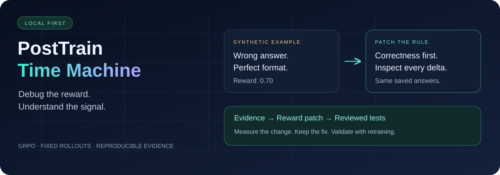
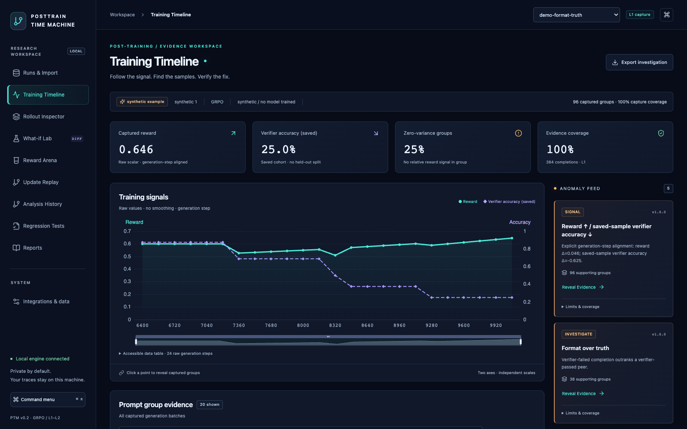
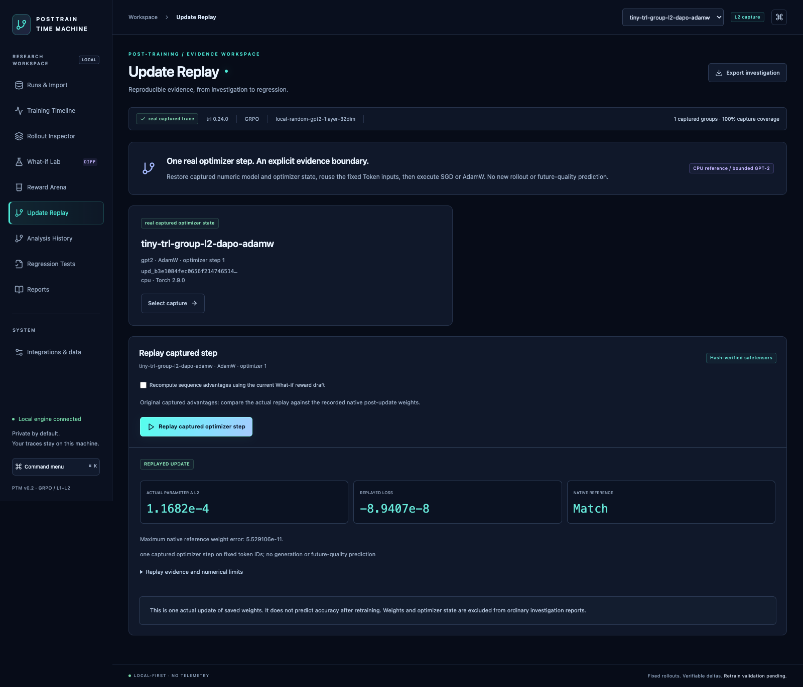
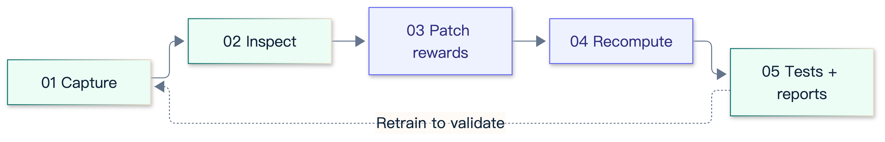
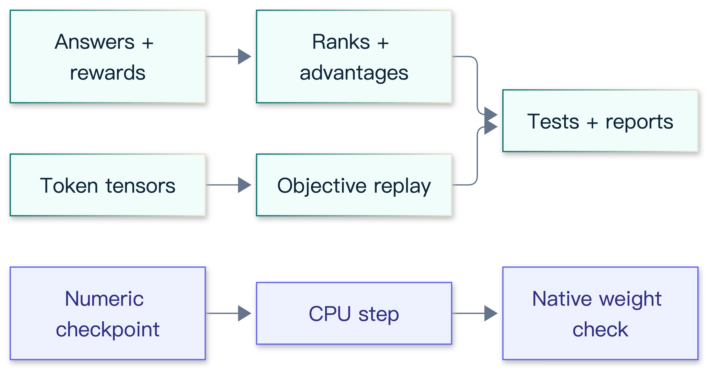

<div align="center">



# PostTrain Time Machine

**Debug why your model learned the wrong thing.**

A local GRPO evidence workspace: timeline → completion → reward patch → reviewed regression test.

[](https://github.com/renweimeng/posttrain-timemachine/actions/workflows/check.yml)
[](https://www.python.org/downloads/)
[](LICENSE)

[简体中文](README.zh-CN.md) · [Download v0.2.0](https://github.com/renweimeng/posttrain-timemachine/releases/tag/v0.2.0) · [Installation options](#more-ways-to-install) · [Integrations](docs/integrations.md)

</div>

Your reward curve is going up. Is your model actually doing the task better, or just getting better at satisfying the scorer?

PTM lets you follow a suspicious metric back to saved completions, inspect reward components, edit a declarative reward rule, and recompute ranks and GRPO advantages on the same answers. Turn the expected ordering into a reviewed contract and keep the incident as a reproducible offline report.



## Start without a GPU

Requires 64-bit Python 3.11 or 3.12. Download the wheel from [Releases](https://github.com/renweimeng/posttrain-timemachine/releases/tag/v0.2.0). In the download directory:

macOS / Linux:

```bash
python3 -m venv .venv
.venv/bin/python -m pip install ./posttrain_timemachine-0.2.0-py3-none-any.whl
.venv/bin/ptm demo
```

Windows PowerShell:

```powershell
py -3.12 -m venv .venv
.\.venv\Scripts\python.exe -m pip install .\posttrain_timemachine-0.2.0-py3-none-any.whl
.\.venv\Scripts\ptm.exe demo
```

Open **http://127.0.0.1:8765**. No activation script, Node.js, API key, account or pretrained-model download is needed for the demo. Initial dependency installation needs the internet; the running app uses bundled local assets. Stop with Ctrl+C. Data lives under `.ptm/` in your working directory.

### More ways to install

Other options: download the [source ZIP](https://github.com/renweimeng/posttrain-timemachine/archive/refs/tags/v0.2.0.zip) and install with `pip install .`, clone the [repository](https://github.com/renweimeng/posttrain-timemachine), use `pip install "git+https://github.com/renweimeng/posttrain-timemachine.git@v0.2.0"` inside a venv, or run `uvx --python 3.12 --from ./posttrain_timemachine-0.2.0-py3-none-any.whl ptm demo` after downloading the wheel. There is no PyPI release or native desktop installer yet.

### Operating systems

| Environment | Application | Deep training / update replay |
|---|---|---|
| macOS | Local end-to-end and isolated-wheel verification; Python 3.11/3.12 CI | Actual CPU reference training and two-process capture tested |
| Linux | Python 3.11/3.12 installation and core/browser CI | Separate pinned TRL reference job passed; GPU requires its own validation |
| Windows | Native PowerShell installation smoke passed on Python 3.11/3.12 | Use WSL2/Linux for the reference examples; native deep training is unverified |

The current release provides a Python wheel and source archives, not an `.exe` or `.dmg` installer. Prebuilt frontend assets are included, so ordinary users do not need Node.js. Mobile layout support is for the browser interface, not a phone-hosted Python server.

## A five-minute investigation

1. Select **demo-format-truth**.
2. Click **Reveal Evidence** on the timeline.
3. Inspect the wrong-but-perfectly-formatted answer and its reward breakdown.
4. Open **What-if Lab** and reduce **Format weight** from `0.7` to `0.05`.
5. **Recompute Deltas** and inspect rank reversals and advantage sign flips.
6. Review the expected fixture ordering and **Save reviewed contract**.
7. Run it in **Regression Tests** and export a report from **Reports**.

Four complete authored Arena challenges cover format over truth, zero signal, verbosity and checker blind spots. Synthetic examples are labeled; real CPU trainer traces are separate.



*The update view uses an actual tiny random-model CPU capture. It checks one real optimizer step, not a future model-quality prediction.*

## Bring your own evidence



Import canonical JSON/JSONL, explicit-field verl JSONL or complete rank bundles in **Runs & Import**. Try the [actual tiny CPU trace](fixtures/trl/captured-events.jsonl). Browser imports are limited to 4 MiB; larger files use `ptm import trace.jsonl --format ptm-jsonl` (128 MiB per file, 2 MiB per JSONL line).

Capture explicit run/batch/prompt-group IDs, completions, rewards and the inputs required by your reward rule. Plain curves or arbitrary trainer logs do not contain enough evidence. After import, use **Load recorded reward** before editing a rule. See [integrations](docs/integrations.md) for actual trainer capture, two-rank CPU capture and retention options.

| Saved evidence | Available operation |
|---|---|
| Complete groups, rewards and scoring inputs | Reward / rank / advantage diff |
| Token IDs, masks and staged policy logprobs | Token signals and supported full-batch scalar objective replay |
| Separate supported numeric checkpoint capture | One real CPU optimizer step from fixed inputs |



## Verified scope

- Actual reference: **TRL 0.24.0** with source-fingerprinted opt-in deep capture.
- Loss references: GRPO, BNPO, DAPO and Dr.GRPO; full rank/microbatch denominators have independent tests.
- Native deep capture: CPU, one process, accumulation=1, iterations=1 and supported loss settings.
- Update replay: bounded local GPT-2, safetensors, native AdamW/SGD; no arbitrary checkpoint upload.
- A real two-process CPU L1 integration is included; native distributed L2 is not validated.
- SFT/DPO/PPO objectives, general Agent framework hooks and future training quality are not automatically supported.

Local acceptance on 2026-11-03: **81 Python tests, 12 browser journeys**, 84.78% statement coverage, real CPU training/updates, offline L2 recomputation and an isolated wheel install without Torch. macOS was verified locally; Linux and Windows smoke coverage is defined in CI, with actual results visible in [Actions](https://github.com/renweimeng/posttrain-timemachine/actions). Native Windows deep training and GPU throughput remain unverified.

Read [test evidence](docs/TEST_REPORT.md), [numerical correctness](docs/numerical-correctness.md), [raw benchmarks](docs/benchmarks/) and [security scope](docs/SECURITY.md). The pinned optional reference extra has known dependency advisories and is separate from the default application.

The server is loopback-only and has no login, telemetry or multi-tenant hosting mode. Text retention is configurable; retaining numeric token IDs is not anonymization. Ordinary report bundles exclude weights and optimizer state.

## Contribute

Bring a minimal reproducible reward failure, reviewed contract, versioned adapter or real reference fixture. See [CONTRIBUTING](CONTRIBUTING.md). If this helps you catch a training bug, a Star or a reproducible issue is welcome.

Apache-2.0. [Sample provenance](DATA_LICENSE.md) · [Architecture](docs/architecture.md) · [Feature boundaries](docs/requirements.md).

## Practical questions

**Do I need an account?** No. Run the application yourself and open the local browser URL. The current app is single-user and loopback-only.

**Where are my records?** In `.ptm/` under your working directory, unless you choose another root. Start `ptm serve .ptm --open` from the same directory to reopen it. Keep the terminal running; Ctrl+C stops the server.

**The port is busy.** Use `ptm demo --port 8767` or `ptm serve .ptm --port 8767`, then visit port 8767.

**The command is missing.** Invoke `.venv/bin/ptm` on macOS/Linux or `.\.venv\Scripts\ptm.exe` on Windows, as shown above. Activation is optional.

**Can I inspect a remote training run?** Download its captured trace, or start PTM on the server and forward the loopback port with `ssh -L 8765:127.0.0.1:8765 user@server.example.com`. Then open localhost:8765 on your computer. Replace the account and hostname with your own.

**Can I import a dataset or a screenshot of a reward curve?** Full analysis needs recorded completions, rewards and explicit group identity. A dataset or curve alone does not reconstruct missing training evidence.

**How do I verify a download?** The release includes `SHA256SUMS` for the named wheel and uploaded source ZIP. Use `shasum -a 256 FILE` on macOS, `sha256sum FILE` on Linux, or `Get-FileHash FILE -Algorithm SHA256` in PowerShell and compare the value. GitHub's automatically generated source archives are separate downloads.

[Full Chinese guide](README.zh-CN.md) · [Third-party notices](NOTICE)
