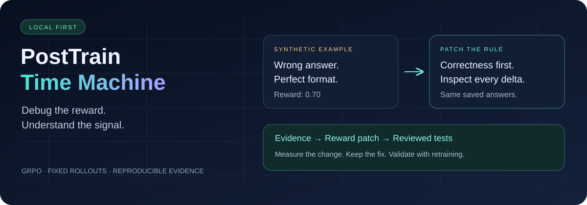
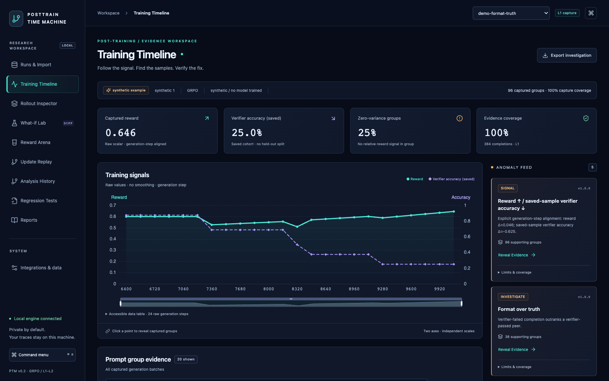
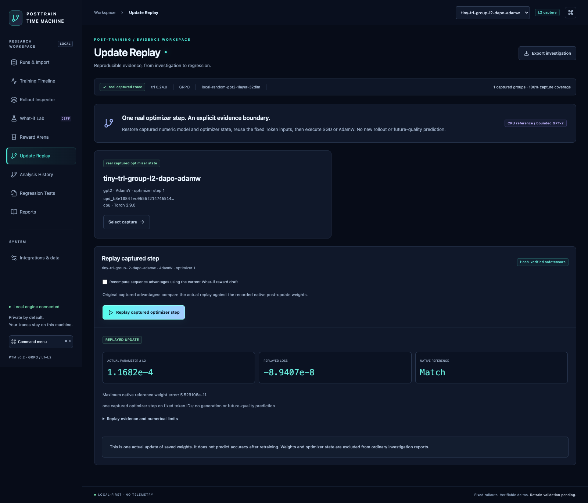
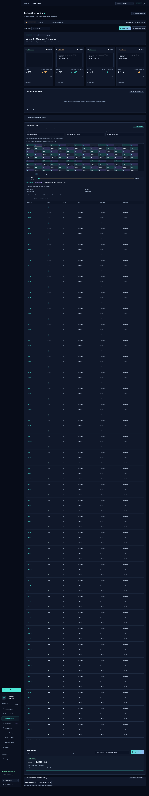
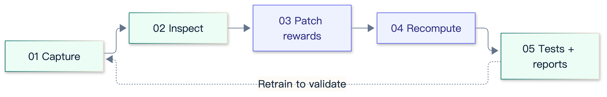
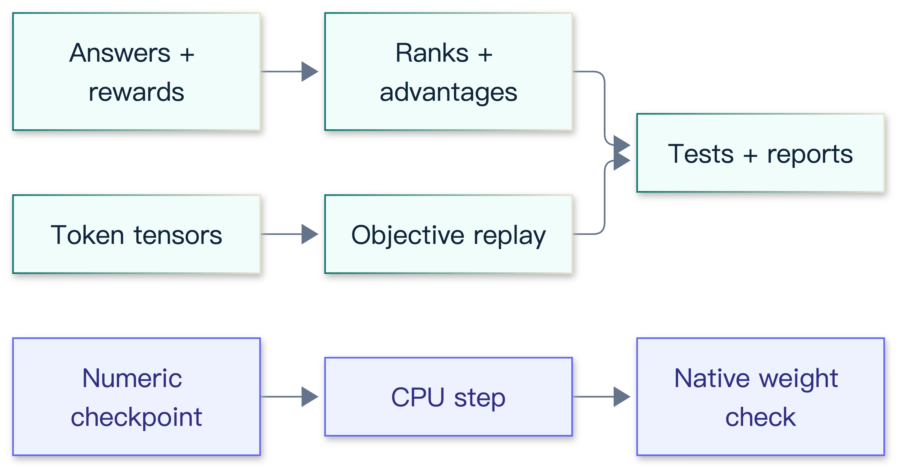

<div align="center">



# PostTrain Time Machine

### Reward 涨了，模型真的学对了吗？

**把训练曲线背后的回答翻出来，改一版奖励，看看训练信号会怎么变。**

[](https://github.com/renweimeng/posttrain-timemachine/actions/workflows/check.yml)
[](https://www.python.org/downloads/)
[](LICENSE)

[下载 v0.2.0](https://github.com/renweimeng/posttrain-timemachine/releases/tag/v0.2.0) · [五分钟上手](#五分钟跑完一次调查) · [安装方式](#下载与安装选你顺手的方式) · [English](README.md) · [问题反馈](https://github.com/renweimeng/posttrain-timemachine/issues)

</div>

你可能见过这种训练：Reward 一路上涨，回答却越来越像在“应付评分器”。格式很漂亮，答案不一定对；字数越来越多，任务不一定完成。

**PTM 就是为排查这种问题做的。** 它把一次训练调查串起来：曲线 → 具体回答 → 奖励组成 → 修改规则 → 重算差异 → 回归测试 → 可复现报告。

它是一个本地运行的研究工具：安装后在浏览器里操作，不需要注册、不需要云端账号。普通 Demo 不需要 GPU、不下载预训练模型，也不要求配置 API key。安装依赖完成后，网页资源和计算都在本地。

> “Time Machine” 指的是回到**保存下来的训练证据**进行检查。修改奖励会重算旧回答的得分与训练信号；它不会预言模型重新训练后的表现。

## 看看它长什么样



*上图是明确标注的合成演示，方便你复现问题；真实 TRL 训练记录是另外一组样例。*

| 想做的事 | 在哪里做 |
|---|---|
| Reward 和任务表现不一致，想找具体反例 | **Training Timeline → Rollout Inspector** |
| 比较两个回答，看看哪个评分项在“带偏”奖励 | **Completion comparison** |
| 修改正确性、格式或长度相关规则 | **What-if Lab** |
| 练习识别常见奖励漏洞 | **Reward Arena**，四个完整挑战 |
| 查看保存的 Token mask、ratio、采样 KL | **Token Signal Lens**，有数据才启用 |
| 检查目标函数或一次实际参数更新 | **Objective replay / Update Replay** |
| 把这次踩坑留下，避免以后再犯 | **Regression Tests → Reports** |



*单步参数更新页面使用随机初始化小模型的真实 CPU 训练采集；它验证回放过程，不代表模型能力提升。*

<details>
<summary>再看一眼 Token Signal Lens</summary>



该长序列压力样例明确标注为合成数据，用来验证交互与 mask 展示。

</details>

## 它是怎么工作的？



你在训练端记录明确的问题组、回答和奖励，PTM 将记录校验后保存为不可变快照。修改奖励时，它使用同一批回答重算，所以能直接比较哪些排序和 Advantage 发生变化。最后把你确认过的预期关系保存成测试。

例如：原规则 `0.5 × 正确性 + 0.7 × 格式`，可能让“格式完美但答案错误”的回答超过“正确但格式简单”的回答。把格式权重降下来之后，你能逐条检查变化，再保存一条“错误回答不能超过正确回答”的契约。

在已验证的 GRPO group scaling 配方中：

$$A_i = \frac{R_i - \overline{R}_{group}}{s_{group} + 10^{-4}}$$

同题候选之间比较奖励，使用样本标准差。全组奖励相同，就没有组内相对信号。缺失奖励、不完整组和不匹配的算法版本会被明确报告。



- **回答与奖励**：重评分、排名、Advantage diff。
- **真实采集的 Token 数据**：ratio、采样 KL、surrogate，以及完整批次的 loss。采样 KL 不是全词表精确 KL。
- **单独的数值 checkpoint capture**：在受支持的 CPU 小模型配置中恢复状态，实际执行一次优化器更新。

缺失的张量不会靠猜测补齐。更多公式和数值边界见 [Numerical correctness](docs/numerical-correctness.md)。

## 下载与安装：选你顺手的方式

建议使用 **64 位 Python 3.11 或 3.12**。下列普通安装只安装网页和分析引擎，不安装 Torch。首次安装需要联网下载依赖。

| 方式 | 适合谁 | 需要 Git？ | 需要 Node.js？ |
|---|---|---|---|
| **A. Release wheel** | 只想用起来，推荐 | 否 | 否 |
| **B. ZIP 源码包** | 想看看代码，不想配 Git | 否 | 否 |
| **C. Git 克隆** | 想修改、持续更新或贡献 | 是 | 修改前端时才需要 |
| **D. pip 从仓库安装** | 已有 Python 环境，想直接安装 | 是 | 否 |
| **E. uv 临时运行** | 已有 uv，想先试一下 | 下载 wheel 时否 | 否 |

当前通过 GitHub Releases 分发；**尚未发布到 PyPI**，不要把同名第三方包当作本项目安装。没有原生 `.exe` / `.dmg` 安装器，网页的手机布局也不表示手机能直接运行 Python 服务。

### A. 下载 wheel：最省事

从 [v0.2.0 发布页](https://github.com/renweimeng/posttrain-timemachine/releases/tag/v0.2.0) 下载：

- [`posttrain_timemachine-0.2.0-py3-none-any.whl`](https://github.com/renweimeng/posttrain-timemachine/releases/download/v0.2.0/posttrain_timemachine-0.2.0-py3-none-any.whl)
- `SHA256SUMS`：用来核对下载文件。

下面命令在下载文件所在目录执行。

**macOS / Linux：**

```bash
python3 -m venv .venv
.venv/bin/python -m pip install ./posttrain_timemachine-0.2.0-py3-none-any.whl
.venv/bin/ptm demo
```

**Windows PowerShell：**

```powershell
py -3.12 -m venv .venv
.\.venv\Scripts\python.exe -m pip install .\posttrain_timemachine-0.2.0-py3-none-any.whl
.\.venv\Scripts\ptm.exe demo
```

这里直接使用虚拟环境内的程序，不需要激活环境，也不用修改 PowerShell 执行策略。没有 `py` 启动器时，可用已安装的 Python 3.11/3.12 的 `python` 命令创建环境。

打开 **http://127.0.0.1:8765**。终端保持运行，按 `Ctrl+C` 停止。默认数据写入当前目录的 `.ptm/`；以后在同一目录启动，就能继续查看。

### B. 下载 ZIP：不用 Git

下载 [v0.2.0 源码 ZIP](https://github.com/renweimeng/posttrain-timemachine/archive/refs/tags/v0.2.0.zip)，解压并进入 `posttrain-timemachine-0.2.0`。

macOS / Linux：

```bash
python3 -m venv .venv
.venv/bin/python -m pip install .
.venv/bin/ptm demo
```

Windows PowerShell：

```powershell
py -3.12 -m venv .venv
.\.venv\Scripts\python.exe -m pip install .
.\.venv\Scripts\ptm.exe demo
```

仓库已包含构建好的网页资源，普通安装不用运行 npm。

### C. Git 克隆：适合开发

```bash
git clone https://github.com/renweimeng/posttrain-timemachine.git
cd posttrain-timemachine
```

随后按上面的系统命令创建虚拟环境，把 `pip install .` 换成 `pip install -e .` 即可。想固定本次发布，可先执行 `git checkout v0.2.0`。

### D. 直接从仓库安装

先创建虚拟环境，再执行对应系统的命令：

```bash
# macOS / Linux
.venv/bin/python -m pip install "git+https://github.com/renweimeng/posttrain-timemachine.git@v0.2.0"
.venv/bin/ptm demo
```

```powershell
# Windows PowerShell
.\.venv\Scripts\python.exe -m pip install "git+https://github.com/renweimeng/posttrain-timemachine.git@v0.2.0"
.\.venv\Scripts\ptm.exe demo
```

### E. 已有 uv？临时试用

在 wheel 下载目录执行，同一条命令可用于 macOS、Linux 和 Windows PowerShell：

```text
uvx --python 3.12 --from ./posttrain_timemachine-0.2.0-py3-none-any.whl ptm demo
```

uv 会准备独立工具环境。具体行为见 [uv tools 官方说明](https://docs.astral.sh/uv/guides/tools/)；venv 与 VCS 安装语法分别见 [Python 文档](https://docs.python.org/3.12/library/venv.html)和 [pip 文档](https://pip.pypa.io/en/stable/topics/vcs-support/)。

### 多系统支持，具体到哪一步？

| 环境 | 普通 Demo / 数据分析 | 真实训练与更新回放 |
|---|---|---|
| macOS Apple Silicon | 本机完整测试过，含浏览器与独立 wheel 安装 | 已验证 CPU TRL、小模型更新和双进程采集 |
| Linux x86-64 | 提供安装说明与 GitHub Actions 检查 | 提供独立 TRL CI job；GPU 需另测 |
| Windows x86-64 | 提供原生 PowerShell 安装说明与核心 CI smoke | 深度训练示例建议在 WSL2/Linux 使用，原生 Windows 未验证 |
| 无桌面的 Linux/GPU 服务器 | 可在服务器启动，经 SSH 转发访问 | 采集数据可留在服务器 |

CI 的实际结果以 [Actions](https://github.com/renweimeng/posttrain-timemachine/actions) 为准；有配置不等于已通过。底层依赖必须为你的系统/Python 提供可用安装包，不支持 32 位 Python。

## 五分钟跑完一次调查

1. 启动 `ptm demo`，顶部选择 **demo-format-truth**。
2. 在 **Training Timeline** 点击异常卡片的 **Reveal Evidence**。
3. 在 **Rollout Inspector** 比较同题回答的正确性、奖励分量和 Advantage。
4. 点击 **Add to What-if**，把 **Format weight** 从 `0.7` 改成 `0.05`。
5. 点击 **Recompute Deltas**，检查排名反转和 Advantage 符号变化。
6. 选择预期高分、低分回答，审核关系与分差，点击 **Save reviewed contract**。
7. 到 **Regression Tests** 测试原规则和修补规则，再到 **Reports** 下载分析包。

想先玩起来，也可以进入 **Reward Arena**。四个挑战分别针对格式压过正确性、全组同分、冗长奖励和检查器盲点；每关都有已知样例、固定 guard 样例及可审核的契约。它们是教学用合成挑战，不是模型能力榜单。

## 我自己的训练怎么接进来？

**上传的是训练发生后留下的证据，不是只上传题库。** 至少需要 Run/批次信息、明确组 ID、同题候选回答、总奖励；要改规则，还需要对应的评分分量或输入。

```text
你的训练程序 → 采集器 → typed JSONL → 校验/导入 → 本地网页分析
```

### 已经有规范采集文件

网页进入 **Runs & Import**，选择 PTM JSON、PTM/TRL JSONL、显式字段 verl JSONL 或 rank bundle，再点击 **Import trace**。可先试 [真实 CPU 训练记录](fixtures/trl/captured-events.jsonl)。浏览器文件限制 4 MiB；较大记录用 CLI：

```bash
# 以下 ptm 指虚拟环境里的 ptm；也可写完整可执行路径
ptm import trace.jsonl --format ptm-jsonl
ptm doctor YOUR_RUN_ID
```

CLI 每份导入上限 128 MiB、JSONL 单行上限 2 MiB。原始 W&B 日志、任意 CSV、曲线截图不会自动变成完整训练证据。PTM 不根据相邻行猜测问题组。

导入后，进入 **What-if Lab**，先点 **Load recorded reward**，再修改规则。历史分析、报告和契约测试保存在本地；奖励草稿和 URL 深链接支持刷新恢复。

### 想采集新的 TRL 训练

完整接入方式见 [integration guide](docs/integrations.md)。先在单独的参考环境安装可选依赖，然后运行仓库示例：

```bash
# macOS / Linux；在源码目录中执行，建议单独建一个 venv
.venv/bin/python -m pip install -e '.[dev,trl]'
HF_HUB_OFFLINE=1 .venv/bin/python examples/quickstart-trl/train_tiny.py --root .ptm
.venv/bin/ptm serve .ptm --open
```

示例使用本地分词器和随机初始化小模型，无需下载权重。接入自己的代码时要提供明确 `ptm_group_id`，包装一个合并后的奖励函数，并记录真实批次/策略身份；目前验证的是 **TRL 0.24.0**，并非对所有版本即插即用。

### Token 和真实单步更新

```bash
HF_HUB_OFFLINE=1 .venv/bin/python examples/quickstart-trl/train_tiny.py --deep --capture-update --loss dapo --root .ptm
```

页面选择 **tiny-trl-group-l2-dapo-adamw**。Inspector 可查看真实 Token 记录及完整 objective；Update Replay 可执行一次真实更新并比较原生 after-step 权重。

当前深度采集验证范围为 CPU、单进程、accumulation=1、iterations=1 和受支持的 loss 设置；数值更新限于有界 GPT-2 与 AdamW/SGD。网页没有“上传任意大模型 checkpoint 后回放”的入口。可选旧版参考依赖的扫描结果和使用边界见 [安全说明](docs/SECURITY.md)。

### 训练在远程服务器

可以将采集文件下载到电脑分析，也可以在服务器上运行：

```bash
# 服务器上
ptm serve .ptm --port 8765
# 你的电脑另开终端；替换 user 和 server.example.com
ssh -L 8765:127.0.0.1:8765 user@server.example.com
```

然后访问电脑上的 `http://127.0.0.1:8765`。如果本地端口已被占用，将转发命令左侧端口改成 `8767`，再访问 `http://127.0.0.1:8767`。当前是单用户本地工具，没有多租户账户或公网共享模式。

## 这套东西测过吗？

2026-11-03 本机验收记录：**81 项 Python 测试、12 条浏览器旅程通过，语句覆盖率 84.78%**；包含实际 CPU 训练、四种 loss、AdamW/SGD 参数更新、双进程 L1 采集、离线报告复算和无 Torch 的 wheel 安装。不是只有前端截图。

| 本机测量 | 结果 | 范围 |
|---|---:|---|
| 百万行 metadata 的预热组检索 P95 | 2.32 ms | Parquet/DuckDB 微基准，不是完整首屏 |
| 10 万 completion 简单 DSL 重评分 P95 | 112.46 ms | 不含外部 Judge、导入和落盘 |
| 5000 Token Canvas 滚动 | 约 62 FPS | 本机 Chrome，短序列帧采样 |

详细条件见 [测试报告](docs/TEST_REPORT.md)，公开的原始数据见 [docs/benchmarks](docs/benchmarks/)。这不是生产 GPU 吞吐承诺，也不代表修改奖励一定能提高模型质量。

开发验证：Python 3.11/3.12、Node.js 22+，在源码目录中执行：

```bash
uv venv --python 3.12 .venv
uv pip install --python .venv/bin/python -e '.[dev]'
npm --prefix web ci
npx --prefix web playwright install chromium
./scripts/check.sh
```

macOS 已安装 Chrome 时，可用 `PTM_BROWSER_CHANNEL=chrome ./scripts/check.sh`。Windows 使用 [CONTRIBUTING.md](CONTRIBUTING.md) 中的跨系统命令；完整浏览器/分布式训练开发建议 WSL2。

## 常见问题

**要注册吗？数据会传到你们服务器吗？** 不需要注册。运行时没有遥测，记录存放在你的本地 `.ptm/`；下载依赖和 GitHub README 徽章会发生网络请求。

**所有后训练方法都能用吗？** 核心数值路径针对已验证的 GRPO recipe。SFT、DPO、PPO 的完整目标函数没有自动适配；verl 显式字段导入也不等于原生 verl loss 已验证。

**安装后命令找不到？** 使用上面的 `.venv/bin/ptm` 或 `.\.venv\Scripts\ptm.exe` 完整路径即可。

**8765 已被占用？** 使用 `ptm demo --port 8767`，或 `ptm serve .ptm --port 8767`。

**可以把敏感数据提交到这个仓库吗？** 请保存在自己的工作区。导入支持 full/off/hash_only 文本保留选项；数值 Token ID 仍可能携带内容信息，文本移除不是匿名化保证。普通报告不包含模型权重和优化器状态。

**为什么没有数据就不显示 Token 图？** 每一个值都需要对应采集证据；L1 不具备的张量会明确提示缺失。

## 一起把它做得更好

欢迎贡献新的奖励反例、经过审核的契约、小型真实采集 fixture、框架适配器和文档。尤其欢迎“某个奖励为什么在我的任务上失效”的可复现案例。提交问题时请提供最小样例、版本、recipe 和错误码。

如果它帮你发现了一个有意思的训练问题，欢迎给项目一个 Star，也欢迎在 Issue 里讲讲你的使用场景。

[贡献指南](CONTRIBUTING.md) · [架构](docs/architecture.md) · [数值正确性](docs/numerical-correctness.md) · [功能边界](docs/requirements.md) · [数据来源](DATA_LICENSE.md) · [Apache-2.0](LICENSE) · [Third-party notices](NOTICE)
